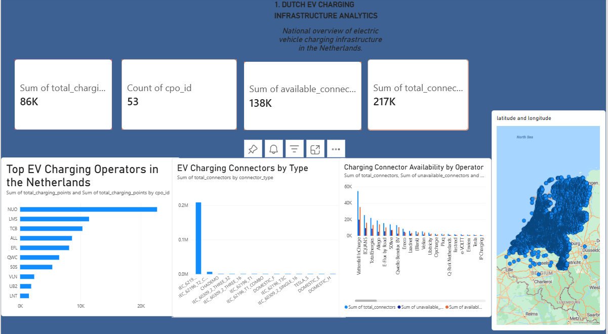
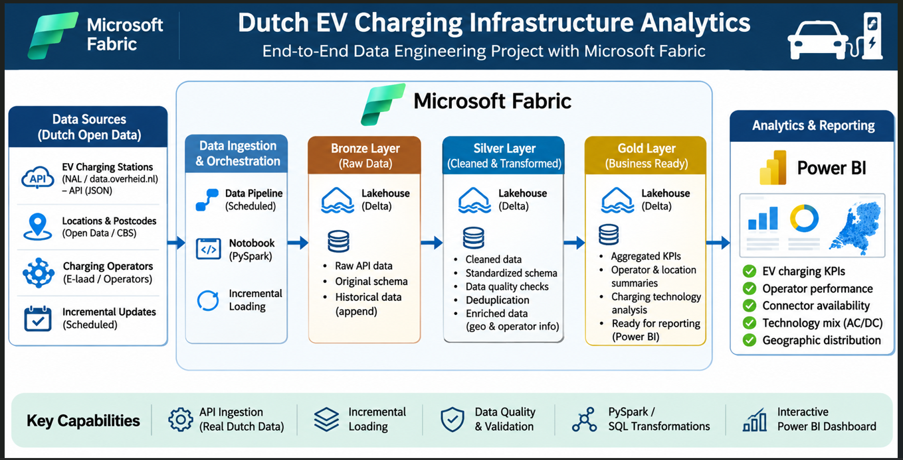

# Dutch EV Charging Infrastructure Analytics

## Project Overview

An end-to-end data engineering and analytics project focused on electric vehicle (EV) charging infrastructure in the Netherlands.

Built using Microsoft Fabric, Python, PySpark, SQL and Power BI, this project transforms Dutch open charging infrastructure data into structured datasets and interactive business insights.

## Project Objectives

- Analyze EV charging infrastructure across the Netherlands.
- Identify charging point operators and their infrastructure distribution.
- Analyze connector types, power technologies and availability.
- Transform raw GeoJSON data into analytical datasets.
- Build an interactive Power BI dashboard.

## Technology Stack

| Technology | Purpose |
|---|---|
| Microsoft Fabric | Data engineering platform |
| Python | Data processing |
| PySpark | Data transformation |
| SQL | Data analysis and validation |
| Delta Lake | Data storage |
| Power BI | Interactive visualization |
| GitHub | Project documentation and version control |

## Data Architecture

The project follows the Medallion Architecture.

### Bronze Layer
- Ingested raw EV charging infrastructure GeoJSON data.
- Stored the original source data in the Lakehouse.

### Silver Layer
- Parsed and transformed GeoJSON records.
- Extracted relevant charging infrastructure attributes.
- Removed 164 exact duplicate records.
- Created a structured Silver Delta table.

**Silver table:** `ev_charging_silver`

Records: 86,044

### Gold Layer

Created analytical tables for reporting and business insights:

| Gold Table | Purpose |
|---|---|
| gold_operator_analysis | Operator-level analysis |
| gold_country_analysis | Country-level distribution |
| gold_charging_technology | Connector and power technology analysis |
| gold_charging_availability | Connector availability analysis |
| gold_geographic_distribution | Geographic charging infrastructure distribution |

## Key Project Results

| Metric | Result |
|---|---:|
| Silver records | 86,044 |
| Unique operators | 53 |
| Geographic records | 86,027 |
| Total connectors | 216,732 |
| Available connectors | 138,077 |
| Unavailable connectors | 78,655 |
| Connector availability rate | 63.7% |

*Note: These results represent the downloaded data snapshot, not guaranteed real-time charging availability.*

## Data Quality Validation

SQL validation checks were performed across the Silver and Gold layers.

Successful checks included:

- Record counts and unique operator IDs.
- Missing operator IDs.
- Missing geographic coordinates.
- Geographic coordinate ranges.
- Connector availability percentages.
- Available versus total connector consistency.
- Negative unavailable connector counts.
- Consistency of connector totals between Silver and Gold tables.

The geographic filtering uses an approximate Netherlands bounding box rather than an official administrative boundary.

## Power BI Dashboard

The dashboard provides an overview of:

- Total charging points.
- Number of operators.
- Total and available connectors.
- Charging infrastructure by operator.
- Connector technology distribution.
- Connector availability by operator.
- Geographic distribution of charging locations.

## Business Value

This project demonstrates how open infrastructure data can be transformed into useful analytical insights.

It provides a practical example of:

- End-to-end data engineering.
- Medallion architecture implementation.
- PySpark and SQL transformations.
- Data quality assurance.
- Analytical data modelling.
- Power BI reporting.

## Author

**Eidmon Tesfaye**

Aspiring Junior Cloud Data Engineer | Microsoft Fabric | Python | PySpark | SQL | Power BI

## Repository

Dutch EV Charging Infrastructure Analytics
## Power BI Dashboard

The following dashboard provides an interactive overview of EV charging infrastructure across the Netherlands.

## Microsoft Fabric Architecture

The following diagram illustrates the end-to-end data engineering architecture, including data ingestion, Bronze, Silver and Gold layers, and Power BI reporting.

Built as part of my Microsoft Fabric and Data Engineering portfolio.
